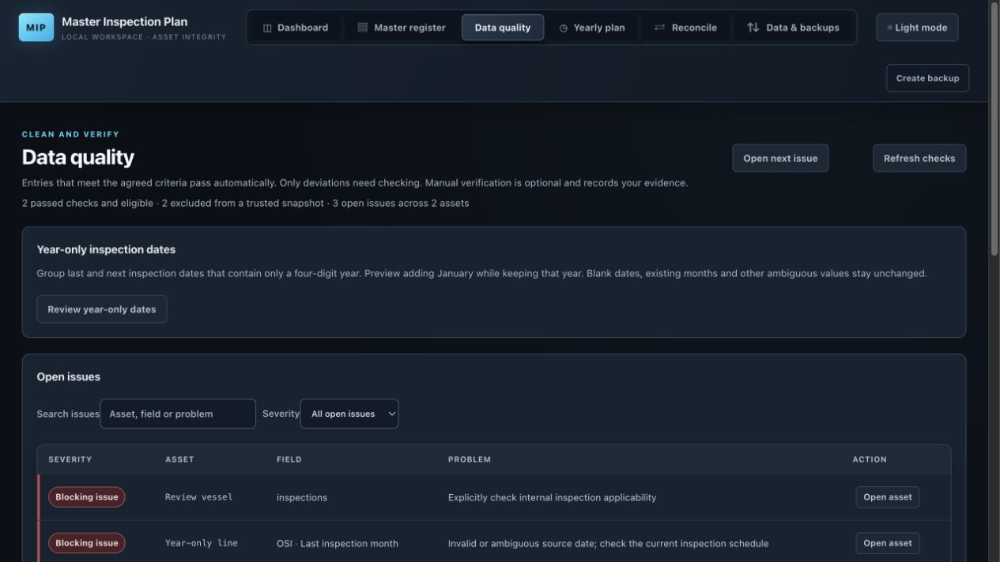

# Full app review — 2 November 2026

## Assessment

**Keep this build as a testing candidate.** The review confirmed **nine actionable findings: one P1 and eight P2s**. The P1 silently removes an independent inspection concern and incorrectly makes the asset snapshot-eligible. The P2s affect preview integrity, duplicate creation, cleanup restart, recovery compatibility and workbook interchange. All remain open; this review changes documentation only.

The requested pre-review commit is **`b9ccfa1fff084226a71ec58fc4108eaf80a9fea7`**, `Add data cleanup, compact backups, and review workflow updates`, on `codex/reliable-master-database`. It captured 41 source/test/documentation files, with 2,114 insertions and 72 deletions. Review covered the current application, prioritizing `18baa3c..b9ccfa1` rather than limiting inspection to that diff.

Three existing untracked distribution ZIPs were left untouched and uncommitted; two contain the reference workbook. Neither those packages nor operational databases, workbooks, backups or recovery copies were used for testing. No application fix, operational migration, merge, push or deployment was performed.

See the [seven-task fix plan](superpowers/plans/2026-11-02-app-review-fixes.md). P1 means high priority before relying on this candidate; P2 means a material defect to repair before release. Priorities describe software behavior, not engineering or regulatory conclusions.

## Findings

### R1 · P1 — An unrelated save clears an independent inspection concern

**Repair:** Implemented with content-sensitive summary ownership. Synthetic export/reimport, unrelated save, readiness and snapshot regression retained the independent concern; generated warnings still resolve.

**Location:** `inspection_app/validation.py:126–148`, `reconcile_import_reviews`; populated-field retention in `inspection_app/quality.py:229–234` makes the import sequence reachable.

The retained `review_summary_generated` boolean authorizes rebuilding the current review summary indefinitely. A later import can supply an independent concern while the old marker remains true. An unrelated editor save then replaces that concern with the old generated date items' summary; if those items are resolved, it clears the status/reason.

**Reproduction:** resolve a generated last-date warning with `2020-01`; export; set the synthetic workbook's inspection status/reason to `Review` / `Confirm scope against drawing D1`; reimport; save only the asset name. Before saving, the concern is present and readiness excludes one asset. Afterward, `review_reason == ''`, `review_status is None`, and readiness excludes zero assets. The coordinating reviewer independently repeated this. No explicit issue resolution occurred.

**Impact and repair:** an outstanding independent concern disappears from the current inspection and the asset becomes snapshot-eligible. Establish ownership of the actual generated summary content; an old boolean alone must never authorize overwriting a later independent reason. Add the complete import/save/readiness/snapshot regression in `tests/test_review_resolution.py`. Preserve raw evidence, automatic eligibility rules and optional verification.

### R2 · P2 — A late bulk preview applies a different field from the visible controls

**Repair:** Bulk and consolidation previews are bound to the current dialog, scope and controls; stale or out-of-order responses cannot enable Apply. Synthetic deferred-response tests and live preview/apply checks cover Plant → set → Synthetic North and changing the consolidation survivor.

**Location:** `static/quality.js:54–60`. Consolidation at `:65–69` has the same response-ownership pattern and needs equivalent tests.

Control changes invalidate the installed preview but not pending requests. A late response installs the obsolete result and enables Apply. Backend revision checks cannot detect this browser-only change of intent.

**Reproduction in a Node VM:** request `Plant = Area 1`; change the selector to `Field` while pending; resolve the original response. Apply becomes enabled and sends the plant preview ID. Rows show asset/before/after without the field, making the mismatch unclear.

**Repair:** bind responses to a generation and immutable operation/scope signature; discard obsolete responses and invalidate on close/reopen. Display the exact field/operation. Test delayed/reversed responses across control, scope and dialog changes, plus consolidation survivor changes. The consolidation test requirement is not an additional separately reproduced finding.

### R3 · P2 — Repeated Save submissions create duplicate new assets

**Repair:** An editor save acquires a synchronous guard, disables submission and editing during the request, and checks its originating editor before closing or discarding a draft. Deferred request and disposable browser failure/double-click checks pass.

**Location:** `static/app.js:167`, editor submit handler.

There is no in-flight guard or disabled submit state. Both pending submissions see an asset without an ID and POST a creation. Existing-asset version checks do not protect creation.

**Reproduction:** a Node VM emitted two identical POSTs before either completed. Disposable HTTP returned `201` twice and persisted two assets. Automatic backup latency makes an ordinary double-click a realistic trigger.

**Repair:** acquire a synchronous save guard before the first await, disable submission, release after failure, and bind completion to its originating editor instance/draft. Test double-submit, failure/retry and late completion after switching editors. Create-request idempotency for disconnected-response retries is a useful follow-up, not an additional demonstrated finding.

### R4 · P2 — Backup-folder changes can make pending cleanup block startup

**Repair:** Pending cleanup is drained under the store lock before changing the authorized folder; a locked quarantine produces a retryable error without changing the setting. Synthetic deletion, retry and restart regressions pass.

**Location:** `inspection_app/cleanup.py:249–260`; `inspection_app/recovery.py:46–61`; startup invokes cleanup from `inspection_app/store.py:39–40`.

Committed file cleanup may finish on restart after a quarantine unlink failure. However, journal validation accepts package paths only under the currently configured copy folder. Changing that folder makes a previously authorized journal appear unsafe.

**Independently reproduced:** delete a synthetic package with `PermissionError` injected only for quarantine unlink. The result warns `Deletion committed; temporary quarantined files will be removed when the app restarts.` Release the failure, change copy folder, reopen Store: `ValueError: Unsafe cleanup journal path`. The journal remains and also blocks subsequent cleanup/restore.

**Repair:** drain pending cleanup before committing a destination change; retain the old setting if cleanup cannot finish. Alternatively persist safely validated original-root authorization; do not loosen path validation. Test deferred removal → folder change → reopening, continued lock failure and retry.

### R5 · P2 — Full recovery cannot repair an existing corrupt source archive

**Repair:** Restore publishes a separate safety package containing current database and damaged evidence before replacing verified archives; failure rolls archive changes back. Collision, publication-failure and retry regressions cover preservation.

**Location:** `inspection_app/recovery.py:153–167`, especially `:160`. This predates the latest diff.

Restore rejects a damaged file occupying the canonical source path even when the package contains verified original bytes.

**Independently reproduced:** import a synthetic workbook, export a valid recovery ZIP, corrupt the live archived workbook, restore that package. It raises `Existing archive checksum mismatch`; the damaged archive remains. This happens before `restore_backup` creates database safety protection. The failed attempt does not replace the live database.

**Impact and repair:** ordinary full recovery cannot heal a natural corruption case. Managed source deletion followed by restore is a workaround, not an adequate normal recovery path. Preserve damaged bytes separately, establish safety protection before modifying files, install verified originals and roll back replacements if DB restore fails. Test repair success and injected failure without weakening package validation.

### R6 · P2 — Listed legacy migration backups cannot be restored

**Repair:** The supported four-column schema is initialized on a disposable copy before validation and restore. Storage and saved-backup HTTP regressions confirm unchanged input, refreshed versions and retained local settings/epoch.

**Location:** `inspection_app/backups.py:90–100`; supported upgrade at `inspection_app/store.py:33–36`. Expanded backup listing now exposes these migration files.

Store supports the older assets table without `details` and creates a pre-migration backup. Listing offers it, but restore validation immediately selects the absent column.

**Independently reproduced:** create a four-column assets table (`id`, `name`, `family`, `version`) and one synthetic row; Store upgrades successfully; select its generated migration backup from `list_backups`. Restore raises `Backup is invalid or could not be restored`, caused by `no such column: details`.

**Repair:** normalize a disposable copy through supported legacy initialization before semantic validation/restoration. Preserve original backup bytes, future-schema rejection and refreshed edit tokens. Test the saved-backup HTTP route as well as storage restoration.

### R7 · P2 — Selected deletion makes an exported workbook unimportable

**Repair:** Export remaps retired IDs to live survivors and unassigns deleted IDs while retaining original IDs in optional Source Cells provenance. Synthetic deletion and consolidation round trips pass.

**Location:** `inspection_app/exports.py:35–37`; selected deletion retains historical references at `inspection_app/cleanup.py:194`.

Export merges retained Source Cells without checking whether referenced assets still exist. Selected deletion preserves evidence, leaving references to absent Assets rows.

**Independently reproduced:** create two synthetic assets with source evidence on one; export/reimport; delete that asset through cleanup; export; preview in a fresh Store. Result: `Source Cells references an unknown asset`, blocking import. The surviving asset and historical evidence remain in the original DB. Clear-register's different reference-removal path is not the trigger.

**Repair:** resolve live aliases, export genuinely absent identities' evidence as unassigned rows, and retain text/coordinates/historical linkage using supported provenance rather than deleting evidence or recreating deleted assets. Test deletion → export → fresh import and consolidated references.

### R8 · P2 — Export drops unassigned Review Items

**Repair:** Export merges retained review evidence with attached reviews and deduplicates exported rows. Repeated synthetic round trips retain unassigned multiline and formula-like values.

**Location:** `inspection_app/exports.py:31–39`. This predates the latest diff.

Import accepts unassigned reviews and retains them in `import_reference`. Export emits attached reviews but does not merge the retained unassigned rows.

**Independently reproduced:** append a synthetic Review Items row with blank `asset_id`, original concern, reason and coordinates; import successfully; immediately export. The output Review Items table is empty. Evidence remains in the DB/original archive, but the loss-preserving interchange omits it.

**Repair:** merge/deduplicate retained unassigned reviews with attached reviews. Test import → export → fresh import comparing every field, including multiline/formula-like text.

### R9 · P2 — Yearly Excel export fails after working-data reset

**Location:** `static/app.js:222`; epoch enforcement at `inspection_app/server.py:144–146`.

The yearly export's raw POST fetch includes the token but omits `X-Data-Epoch`. Reset rotates the epoch; even freshly reloaded pages still omit it. Reload cannot fix the error.

**Reproduction through disposable in-process HTTP:** after reset, the UI's headers receive `400: Working data was reset. Reload this page before making changes.` The same yearly payload with the current epoch receives `200` and XLSX bytes.

**Repair:** share token/epoch header construction between JSON and binary POST paths. Test reset → reload → yearly Excel download and retain rejection of genuinely stale pages.

## Verification and review coverage

| Check | Fresh result |
| --- | --- |
| `python3 -m unittest discover -s tests` | **232 passed**, zero skipped, 14.916 seconds |
| `node --test tests/*.test.cjs` | **83 passed**, zero skipped |
| Python syntax using `ast.parse` | 25 application/tool files passed |
| `node --check` on `static/*.js` | All four files passed |
| `git diff --check` and updated Markdown local-link checks | Passed |
| `python3 tools/benchmark_master.py` | Disposable 10,000-asset, 78.44 MB database |
| Targeted synthetic reproductions | Confirmed the failures despite passing existing tests |

The full Python run included the listening-socket test; historical sandbox skips do not apply to this run. Focused reviewers also ran relevant suites; those overlapping counts are not additional unique tests. No operational workbook/database was opened.

Read-only review covered storage/migrations/mutations, backup/recovery/cleanup, startup/directory locking, original workbook layouts/import/identity matching, reconciliation/consolidation, quality/readiness/verification/snapshots, register/month scheduling, exports, browser drafts/selections, HTTP protections/reset guards, folder picking and packaging. Independent reviewers worked on bounded subsystem slices; the coordinating reviewer independently repeated R1 and R4–R8 and ran the full suites/browser/benchmark. Local HTTP protection inspection is not an exhaustive security assessment.

Existing strengths include serialized access, non-reused edit tokens, transactional correction events, explicit identity decisions, protection of verified corrections, bounded decompression, atomic backup publication, deletion confirmation and source-gap manifests. These do not cover the failing sequences above.

### Live browser smoke check

A separate localhost server used four newly generated synthetic records: overdue line, condition-scheduled line, year-only line and vessel with an applicability blocker. No operational server or existing user tab was used.

- Dashboard distinguished valid overdue work, recorded conditions, inspection-date issues and asset-level blockers.
- Quality initially showed two passing assets, two exclusions and three issues.
- Year-only preview grouped two dates by year; apply set January and raised passing assets to three. Undo restored original dates and exclusions.
- A named snapshot was saved/listed with two included and two excluded. Publication/listing was checked; browser-downloaded file contents were not inspected.
- Data & backups listed compressed backups, import evidence and managed categories. Reset preview listed four assets, dependencies/files and the exact confirmation phrase; Apply stayed disabled with blank confirmation. The preview was canceled without deletion.
- Browser sessions intermittently discarded test tabs; fresh tabs resumed the same disposable server. This limited continuity and is not attributed to app code.

### Performance

On macOS arm64 / Python 3.14.6, the existing disposable benchmark measured register page **0.153 s**, register filter **0.161 s**, editor below displayed 0.001-second precision, quality first query **0.344 s**, warm query **0.339 s**. One local run is not a latency guarantee or complete browser/import/backup performance profile.

## Documentation and release gates

README, task state, data-contract caveats, acceptance status, earlier review follow-up and Windows status now link this review. Historical verification remains labeled as historical. Task state no longer requires mandatory verification/location or indefinite preservation of an uncommitted tree; current owner rules and the explicit commit-first request supersede those statements.

Before release, repair R1–R9 with failing-then-passing regressions, rerun full suites and relevant round trips/failure paths, then repeat affected disposable browser flows. Native Windows launch/file-lock/picker behavior, packaged macOS launch, actual download/printing acceptance, full keyboard/screen-reader/contrast/zoom acceptance, power-loss/disk-full behavior and owner source/identity/engineering acceptance remain unverified by this review. Existing ambiguous workbook rows still require owner decisions. No absence-of-defects or safety certification is claimed.
